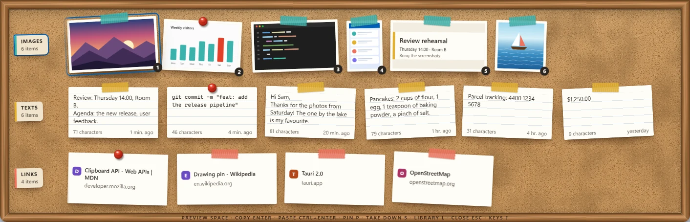

<p align="center">
  
</p>

<h1 align="center">Panopin</h1>

<p align="center">
  <strong>Everything you copy, pinned to a cork board.</strong><br>
  A fast, fully local clipboard and screenshot shelf for Windows.
</p>

<p align="center">
  <a href="https://github.com/MehmetBurakTaskaya/panopin/releases/latest">Download</a> ·
  <a href="README.tr.md">Türkçe</a> ·
  <a href="CHANGELOG.md">Changelog</a>
</p>



<!-- GIF placeholder: copy something, press Win+Alt+V, choose a card, press Enter to paste it back
     (site/assets/demo.gif). -->

Copy a text, a link or an image, or take a screenshot: Panopin keeps it, quietly. Press
**Win+Alt+V** and a cork board slides down with three rows — Images, Texts and Links. Choose with
the keyboard, press **Enter**, and the item is on your clipboard, the board is gone and you are
back where you were. Pin what you want to keep; the rest expires on its own schedule. A Library
window holds everything, with folders, tags, notes and search.

## Features

- **A cork board of your own.** Copies are taped to the board, the ones you keep get a pushpin,
  and small paper-and-cork sounds go with it (they can be turned off).
- **Native and light.** Built with Tauri and Rust. The installer is about 3.3 MB
  and Panopin uses almost no CPU while idle: the clipboard is followed through Windows events, never
  polled.
- **Respects privacy.** Copies that password managers and Windows mark as private are never
  saved. Excluded apps, and a pause for 5 minutes, an hour or until you resume.
- **Windows OCR built in.** Text inside screenshots becomes searchable in Turkish and English with
  the OCR that comes with Windows' language packs — no model to download.
- **Works with your screenshots.** Snipping Tool snips (Win+Shift+S), the Screenshots folder and
  screen recordings arrive on the board; Win+Alt+S snips straight into the crop editor.
- **Preview and edit.** Space previews a card. Edit texts; mark up images with a pen,
  highlighter, shapes, arrows, text and pixelation; crop. The original is always kept.
- **Fluent design.** Mica, your Windows accent colour, light and dark themes, per-monitor DPI and
  multiple monitors.
- **Made for Turkish too.** Search that knows İ and ı, optional accent-free matching, and default
  shortcuts that never block AltGr characters such as ₺, @ and €.
- **Keyboard first.** Every action has a key, and Ctrl+K opens a command palette that lists them.
- **Easy to install.** A per-user installer that needs no administrator rights, and a portable
  ZIP.

## Install

1. Download **Panopin-Setup-x64.exe** from the
   [latest release](https://github.com/MehmetBurakTaskaya/panopin/releases/latest) and run it. It
   installs for your user only and needs no administrator rights.
2. Panopin is not code-signed yet (certificates cost money; see [docs/SIGNING.md](docs/SIGNING.md)),
   so Windows SmartScreen may say "Windows protected your PC". Choose **More info → Run anyway**.
   Each release lists the SHA-256 of its files in `SHA256SUMS.txt` if you want to check your
   download.
3. Requirements: Windows 10 22H2 or Windows 11, x64, and Microsoft Edge WebView2, which Windows 11
   already has (on Windows 10 the installer fetches it when it is missing).

**Portable:** unzip **Panopin-Portable-x64.zip** anywhere and run `Panopin.exe`. Your data still
lives in `%APPDATA%\Panopin`. The portable build tells you about new versions; you download them
yourself.

**Updates:** turn on "Check for updates" in Settings → Updates. Panopin then checks GitHub at
start and every 6 hours, marks the tray icon when a version is available, and installs it only
when you press "Update and restart". Your items and settings stay.

macOS support is planned for a later version.

## Shortcuts

Global shortcuts can be changed in Settings → Shortcuts.

| Action | Default |
| --- | --- |
| Open or close the shelf | Win+Alt+V |
| Open the shelf with search | Win+Alt+C |
| Snip the screen onto the shelf | Win+Alt+S |
| Library, copy the last image, pause capture | not set |

On the shelf:

| Key | Action |
| --- | --- |
| Arrow keys, 1–9 | Move between cards and rows, pick a card in the row |
| Enter | Copy, close the shelf and go back to your app |
| Ctrl+Enter | Paste into the app you came from |
| Ctrl+C | Copy and keep the shelf open |
| Space | Preview |
| P · Alt+P · Shift+P · Ctrl+Shift+T | Pin · name · folder · tags |
| S | Take off the shelf (unsaved items go to Trash) |
| Delete · Backspace | Move to Trash · undo |
| E · M · C | Edit a text · mark up an image · crop an image |
| Shift+S | Search |
| Shift+I · Shift+T · Shift+L | Hide or show images · texts · links |
| F | Pinned only |
| Ctrl+K | Command palette |
| Ctrl+O · Ctrl+Shift+C | Open a link · copy the text in an image |
| L | Open the Library |
| Esc | Close the preview, then the shelf |

## Privacy

- Everything stays on your computer: no account, no cloud, no telemetry, no analytics and no
  crash reports.
- Panopin goes online for only two things, both off until you turn them on in Settings: **link
  previews** and **update checks**. Both are made by the app's Rust core, never by its web view.
  Link previews never visit local or private network addresses, plain `http` links or links that
  carry passwords or tokens, and they load no scripts.
- Copied content is never written to log files.
- Your data is not encrypted. **Panopin is not a password vault.**
- Data lives in `%APPDATA%\Panopin` (database and media). The uninstaller asks whether to remove
  it.
- Sounds stay quiet during presentations, full-screen games and Focus sessions. A Do Not Disturb
  that you turn on by hand may go unnoticed, because Windows offers no public way to read it.

## Resource use

Measured with the v1.0.0 release build on a Windows 11 25H2 laptop (AMD Ryzen 9 7940HS,
16 GB), one minute after start, with the shelf closed. Memory is the private working set,
as Task Manager shows it.

| | |
| --- | --- |
| Installer | 3.3 MB |
| CPU while idle | 0.2 s of CPU time per minute, about 0.02 % of the processor |
| Memory while idle | about 120 MB: 10 MB for Panopin and 110 MB for its six WebView2 processes |

## Build from source

You need Windows 10 or 11, [Rust](https://rustup.rs) stable with the MSVC toolchain, Node.js 22.12
or later, and the Visual Studio Build Tools with the C++ workload.

```powershell
npm install
npm run tauri dev      # run in development
npm run tauri build    # build the installer
```

Checks run in CI on every push: `npm run typecheck`, `npm run lint`, `npm test`,
`npm run check:i18n`, `npm run check:licenses`, `npm run check:third-party`, and in `src-tauri/`
`cargo fmt --all --check`, `cargo clippy --all-targets -- -D warnings`, `cargo test` and
`cargo deny check`.

If your checkout path is long, set `CARGO_TARGET_DIR` to a short folder first, for example
`%LOCALAPPDATA%\panopin-build`.

## Contributing

Issues and pull requests are welcome; for larger changes, please open an issue first. Keep the
checks above green, put every new UI string in both `locales/en.json` and `locales/tr.json`, and
use only dependencies under the licences listed in `src-tauri/deny.toml`. The design is described
in [docs/ARCHITECTURE.md](docs/ARCHITECTURE.md), and the reasons behind it in
[docs/DECISIONS.md](docs/DECISIONS.md).

## Licence

[MIT](LICENSE) © 2026 Mehmet Burak Taşkaya. Panopin is built on open-source packages listed with
their licences in [THIRD_PARTY_NOTICES.txt](THIRD_PARTY_NOTICES.txt).

---

<p align="center">Made by Mehmet Burak Taşkaya · <a href="https://mehmetburaktaskaya.com">mehmetburaktaskaya.com</a></p>
