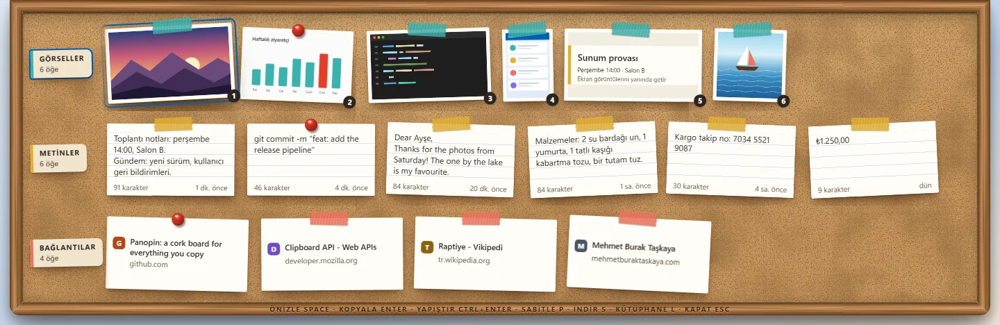

<p align="center">
  
</p>

<h1 align="center">Panopin</h1>

<p align="center">
  <strong>Kopyaladığın her şey, mantar panoda raptiyeyle.</strong><br>
  Windows ve macOS için hızlı ve tamamen yerel çalışan bir pano ve ekran görüntüsü rafı.
</p>

<p align="center">
  <a href="https://github.com/MehmetBurakTaskaya/panopin/releases/latest">İndir</a> ·
  <a href="README.md">English</a> ·
  <a href="CHANGELOG.md">Değişiklikler</a>
</p>



<!-- GIF yeri: bir şey kopyala, Win+Alt+V'ye bas, bir kart seç, Enter ile geri yapıştır
     (site/assets/demo.gif). -->

Bir metin, bağlantı ya da görsel kopyala veya ekran görüntüsü al: Panopin onu sessizce saklar.
**Win+Alt+V**'ye bastığında Görseller, Metinler ve Bağlantılar satırlarıyla bir mantar pano
ekranın kenarından kayarak gelir. Klavyeyle seç, **Enter**'a bas: öğe panoya kopyalanır, raf
kapanır ve kaldığın yere dönersin. Saklamak istediklerini sabitle; gerisi kendi süresi dolunca
gider. Hepsi klasörler, etiketler, notlar ve aramayla birlikte Kütüphane penceresinde durur.

## Özellikler

- **Kendine ait bir mantar pano.** Kopyaladıkların bantla tutturulur, saklamak istediklerine
  raptiye saplanır; kâğıt ve mantar sesleri eşlik eder (kapatılabilir).
- **Native ve hafif.** Tauri ve Rust ile yazıldı. Kurulum dosyası yaklaşık 3,4 MB;
  Panopin boştayken neredeyse hiç işlemci kullanmaz, çünkü pano yoklanmaz, Windows olaylarıyla izlenir.
- **Gizliliğe saygılı.** Parola yöneticilerinin ve Windows'un gizli olarak işaretlediği kopyalar
  hiç kaydedilmez. Hariç tutulan uygulamalar listesi ve 5 dakika, 1 saat ya da sen açana kadar
  yakalamayı duraklatma var.
- **Yerleşik Windows OCR.** Ekran görüntülerindeki yazılar, Windows dil paketleriyle gelen OCR
  sayesinde Türkçe ve İngilizce aranabilir olur; ayrıca model indirilmez.
- **Ekran görüntülerinle birlikte çalışır.** Ekran Alıntısı Aracı (Win+Shift+S), Ekran
  Görüntüleri klasörü ve ekran kayıtları rafa gelir; Win+Alt+S ile alınan kesim doğrudan kırpma
  editöründe açılır.
- **Önizle ve düzenle.** Boşluk tuşu kartı önizler. Metinleri düzenle; görsellerin üzerine kalem,
  vurgulayıcı, şekil, ok, yazı ve pikselleştirmeyle işaretle, kırp. Orijinal her zaman saklanır.
- **Fluent tasarım.** Mica, Windows vurgu rengin, açık ve koyu tema, monitör başına DPI ve çoklu
  monitör desteği.
- **Türkçe dostu.** İ ile ı'yı bilen arama, istersen aksansız eşleştirme ve ₺, @, € gibi AltGr
  karakterlerini asla engellemeyen varsayılan kısayollar.
- **On iki dil.** İngilizce, Almanca, İspanyolca, Fransızca, İtalyanca, Brezilya Portekizcesi,
  Türkçe, Rusça, Arapça (sağdan sola), Japonca, Korece ve Basitleştirilmiş Çince. Panopin
  sistemin dilini izler; Ayarlar'dan değiştirilebilir.
- **Önce klavye.** Her işin bir tuşu var; Ctrl+K hepsini listeleyen komut paletini açar.
- **Kolay kurulum.** Yönetici izni istemeyen, yalnızca senin kullanıcın için kurulan bir
  kurulum dosyası ve taşınabilir ZIP.

## Kurulum

1. [Son sürümden](https://github.com/MehmetBurakTaskaya/panopin/releases/latest)
   **Panopin-Setup-x64.exe** dosyasını indirip aç. Panopin hemen, yalnızca senin kullanıcın için
   kurulur; yönetici izni istemez, tıklanacak sayfa yoktur ve bitince açılır.
2. Panopin henüz kod imzalı değil (sertifikalar ücretli; bkz. [docs/SIGNING.md](docs/SIGNING.md)).
   Bu yüzden Windows SmartScreen "Windows kişisel bilgisayarınızı korudu" diyebilir: **Ek bilgi →
   Yine de çalıştır**'ı seç. İndirdiğin dosyayı kontrol etmek istersen her sürüm, dosyalarının
   SHA-256 değerlerini `SHA256SUMS.txt` içinde listeler.
3. Gereksinimler: Windows 10 22H2 ya da Windows 11, x64 ve Microsoft Edge WebView2. Windows 11'de
   zaten vardır; Windows 10'da eksikse kurulum dosyası onu indirir.

**Taşınabilir:** **Panopin-Portable-x64.zip** dosyasını istediğin yere aç ve `Panopin.exe`'yi
çalıştır. Verilerin yine `%APPDATA%\Panopin` altında durur. Taşınabilir sürüm yeni sürümleri
haber verir; indirmeyi sen yaparsın.

**Güncellemeler:** Ayarlar → Güncellemeler'de "Güncellemeleri denetle"yi aç. Panopin açılışta ve
6 saatte bir GitHub'a bakar, yeni sürüm varsa tepsi simgesine bir işaret koyar ve yalnızca sen
"Güncelle ve yeniden başlat"a bastığında kurar. Öğelerin ve ayarların korunur.

**macOS:** **Panopin-macOS.dmg** dosyasını indir (macOS 13 ya da sonrası, Apple silicon ve Intel),
aç ve Panopin'i Uygulamalar klasörüne sürükle. Panopin Apple onaylı (notarised) değil, bu yüzden
macOS ilk açılışı engeller:

1. Panopin'i aç. macOS onu doğrulayamadığını söyleyince uyarıyı macOS'unda hangisi varsa **Bitti**
   ya da **Vazgeç** ile kapat (Çöp Sepeti'ne Taşı ile değil).
2. **Sistem Ayarları → Gizlilik ve Güvenlik**'i aç, aşağı kaydır ve Panopin'in yanındaki **Yine de
   Aç**'ı seç. Düğme, açmayı denedikten sonra yaklaşık bir saat orada kalır.
3. Yine **Yine de Aç**'ı seç ve Mac'inin parolasını gir. Bundan sonra Panopin her uygulama gibi
   açılır.

Ya da Terminal'de: `xattr -dr com.apple.quarantine /Applications/Panopin.app`.

Panopin menü çubuğunda yaşar. macOS, ekran görüntülerinin kaydedildiği Masaüstü'nü
okumak için bir kez izin ister; ⌘Enter'ın senin yerine yapıştırması için Panopin'e **Gizlilik ve
Güvenlik → Erişilebilirlik**'te izin ver (bir güncellemeden sonra macOS yeniden sorabilir). Mac'te
kısayollar ⌥⌘V, ⌥⌘C ve ⌥⌘S.

## Kısayollar

Global kısayollar Ayarlar → Kısayollar'dan değiştirilebilir.

| İş | Varsayılan |
| --- | --- |
| Rafı aç veya kapat | Win+Alt+V |
| Rafı aramayla aç | Win+Alt+C |
| Ekran kesimini rafa al | Win+Alt+S |
| Kütüphane, son görseli kopyala, yakalamayı duraklat | atanmamış |

Rafta:

| Tuş | İş |
| --- | --- |
| Ok tuşları, 1–9 | Kartlar ve satırlar arasında gez, satırdaki kartı seç |
| Enter | Kopyala, rafı kapat ve uygulamana dön |
| Ctrl+Enter | Geldiğin uygulamaya yapıştır |
| Ctrl+C | Kopyala, raf açık kalsın |
| Boşluk | Önizleme |
| P · Alt+P · Shift+P · Ctrl+Shift+T | Sabitle · isim ver · klasör · etiketler |
| S | Raftan indir (saklanmayan öğeler Çöp Kutusu'na gider) |
| Delete · Backspace | Çöp Kutusu'na taşı · geri al |
| E · M · C | Metni düzenle · görseli işaretle · görseli kırp |
| Shift+S | Ara |
| Shift+I · Shift+T · Shift+L | Görselleri · metinleri · bağlantıları gizle veya göster |
| F | Yalnızca sabitlenenler |
| Ctrl+K | Komut paleti |
| Ctrl+O · Ctrl+Shift+C | Bağlantıyı aç · görseldeki yazıyı kopyala |
| L | Kütüphane'yi aç |
| Esc | Önce önizlemeyi, sonra rafı kapat |

## Gizlilik

- Her şey bilgisayarında kalır: hesap, bulut, telemetri, analitik ya da çökme raporu yok.
- Panopin internete yalnızca iki iş için çıkar ve ikisi de sen Ayarlar'dan açana kadar kapalıdır:
  **bağlantı önizlemeleri** ve **güncelleme denetimi**. İkisini de uygulamanın web görünümü değil,
  Rust çekirdeği yapar. Bağlantı önizlemeleri yerel ya da özel ağ adreslerine, düz `http`
  bağlantılarına ve parola ya da token taşıyan bağlantılara hiç gitmez; sayfalardaki betikleri
  çalıştırmaz.
- Kopyalanan içerik asla log dosyalarına yazılmaz.
- Verilerin şifrelenmez. **Panopin bir parola kasası değildir.**
- Veriler `%APPDATA%\Panopin` altında durur (veritabanı ve medya). Kaldırırken silinip
  silinmeyeceği sorulur.
- Sunumlarda, tam ekran oyunlarda ve Odaklanma oturumlarında sesler çalmaz. Elle açtığın Rahatsız
  Etmeyin modu fark edilmeyebilir, çünkü Windows bunu okumanın herkese açık bir yolunu sunmuyor.

## Kaynak kullanımı

v1.0.0 sürüm derlemesiyle, Windows 11 25H2 çalışan bir dizüstünde (AMD Ryzen 9 7940HS, 16 GB),
açılıştan bir dakika sonra ve raf kapalıyken ölçüldü. Bellek, Görev Yöneticisi'nin gösterdiği
özel çalışma kümesidir.

| | |
| --- | --- |
| Kurulum dosyası | 3,3 MB |
| Boştayken işlemci | dakikada 0,2 sn işlemci zamanı, işlemcinin yaklaşık %0,02'si |
| Boştayken bellek | yaklaşık 120 MB: Panopin için 10 MB, altı WebView2 işlemi için 110 MB |

## Kaynaktan derleme

Windows 10 ya da 11, MSVC araç zinciriyle [Rust](https://rustup.rs) stable, Node.js 22.12 ya da
üstü ve C++ iş yüküyle Visual Studio Build Tools gerekir.

```powershell
npm install
npm run tauri dev      # geliştirme modunda çalıştır
npm run tauri build    # kurulum dosyasını derle
```

CI her push'ta şu kontrolleri çalıştırır: `npm run typecheck`, `npm run lint`, `npm test`,
`npm run check:i18n`, `npm run check:licenses`, `npm run check:third-party`, `src-tauri/` içinde
de `cargo fmt --all --check`, `cargo clippy --all-targets -- -D warnings`, `cargo test` ve
`cargo deny check`.

Projeyi uzun bir klasör yoluna indirdiysen önce `CARGO_TARGET_DIR`'i kısa bir klasöre ayarla,
örneğin `%LOCALAPPDATA%\panopin-build`.

## Katkı

Issue ve pull request'ler memnuniyetle karşılanır; büyük değişiklikler için lütfen önce bir issue
aç. Nasıl yapılacağı [CONTRIBUTING.md](CONTRIBUTING.md)'de anlatılıyor (İngilizce). Özellikle
çeviriler: İngilizce dışındaki bütün diller makineyle çevrildi ve anadili o dil olanların gözden
geçirmesini bekliyor.

## Lisans

[MIT](LICENSE) © 2026 Mehmet Burak Taşkaya. Panopin'in üzerine kurulduğu açık kaynak paketler ve
lisansları [THIRD_PARTY_NOTICES.txt](THIRD_PARTY_NOTICES.txt) dosyasında listelenir.

---

<p align="center">Made by Mehmet Burak Taşkaya · <a href="https://mehmetburaktaskaya.com">mehmetburaktaskaya.com</a></p>
